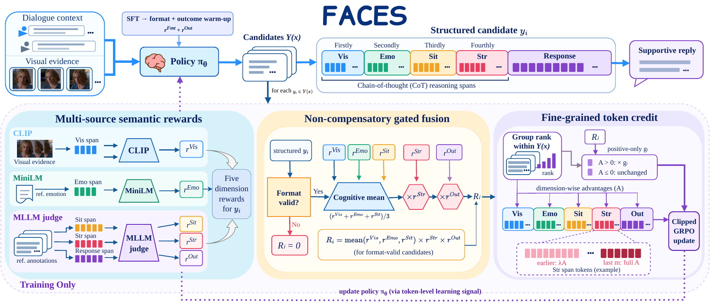

# FACES

🎉 Code and reproduction instructions for **FACES: Fine-grained Gated Semantic
Alignment for Multimodal Emotional Support Conversation**.

FACES connects multimodal understanding with appropriate emotional support
through **SFT → format-and-outcome GRPO warm-up → full FACES GRPO**.

## 🗂️ Repository guide

| Directory | Contents |
| --- | --- |
| [configs](configs/README.md) | Default path references and protocol settings |
| [data](data/README.md) | Compressed training, validation, and evaluation inputs |
| [src](src/README.md) | Training, adapter merging, and data construction |
| [experiments](experiments/README.md) | Generation and experiment-specific evaluation |
| [figures](figures/) | Original paper figures and PDF previews |
| [tools](tools/README.md) | Data unpacking and PDF preview rendering |

## 🧭 Method overview

- **Multi-source rewards:** CLIP scores Visual, frozen MiniLM scores Emotion,
  and Qwen3-VL-8B-Instruct scores Situation, Strategy, and Outcome using three
  prompt variants and the corresponding reference annotations.
- **Non-compensatory fusion:** format-invalid candidates receive zero reward.
  Valid candidates use `R = mean(Visual, Emotion, Situation) × Strategy × Outcome`.
- **Fine-grained credit:** dimension-wise group ranks determine semantic-span
  advantages. The total-reward gate scales positive advantages only. The final
  five tokens of each span receive full advantage; earlier tokens receive 0.8
  times that advantage. Clipped GRPO updates the policy with these token advantages.

<p align="center">
  <a href="figures/FACES_MAIN5.pdf"></a>
</p>

The original paper figures are available in [figures/](figures/).

## 🚦 Reproduction roadmap

Run all commands from the repository root, the directory containing this README.
The numbered sections below follow the order needed for reproduction.

| Step | Action | What the next step uses |
| --- | --- | --- |
| 1 | Install dependencies and unpack the data | JSONL/CSV inputs and Python environment |
| 2 | Download public models and prepare visual assets | Local model directories and dataset frame paths |
| 3 | Train SFT, warm-up GRPO, and FACES; merge each selected adapter | `checkpoints/faces_main/` |
| 4 | Prepare FIRES, generate fixed candidates, and run automatic/Qwen evaluation | Aligned responses and locally computed metrics |
| 5 | Run cross-family, API, human, and supplementary experiments as needed | Additional comparisons under the documented protocols |

The [paper-to-code map](experiments/SUPPLEMENTARY_CODE_MAP.md) links each
experiment to its implementation. Each module's README provides its commands
and required inputs; shared settings are listed in
[paper_protocols.json](configs/paper_protocols.json).

## ⚙️ 1. Environment and data

Use Python 3.10 or newer and a CUDA-compatible PyTorch installation. The paper
uses two NVIDIA A6000 GPUs for training and one RTX A6000 for deployment
benchmarking. The training launchers below expose two GPUs: SFT uses distributed
training; GRPO places the policy on `cuda:0` and the reward critic on `cuda:1`.
The default full-FACES launcher places CLIP and MiniLM on CPU.

```bash
python3 -m venv .venv
source .venv/bin/activate
pip install -r requirements.txt
python tools/unpack_data.py
```

Install a PyTorch build compatible with your CUDA environment. Transformers
must support both Qwen2.5-VL and Qwen3-VL; SFT additionally uses `ms-swift`.
The AWQ judge requires an AWQ backend compatible with the evaluation
installation. A separate evaluation environment can be used when its backend
has different dependency requirements from training.

| Dataset | Split sizes | Use |
| --- | --- | --- |
| MESC-FT | 3,310 train / 368 validation / 450 test | Training, checkpoint selection, and in-domain evaluation |
| MELD-ESC300 | 300 test | External evaluation with preceding-utterance frames |
| StickerConv | 300 test | External evaluation with textual sticker cues |
| AvaMERG | 300 test | External evaluation with five facial frames and dialogue, excluding audio |
| EPITOME-Reddit | Three support-skill CSV files | Training the DIFF-EPITOME scoring model |

The unpacker creates `.jsonl` and `.csv` files beside the supplied `.gz` inputs.
MESC-FT targets use `<think>...</think><response>...</response>`; external
assistant targets are response-only. Image paths are relative to the repository
root. See [the data guide](data/README.md) for schemas and upstream terms.

## 📥 2. Prepare models and visual assets

Download complete public model snapshots, including tokenizer and processor
files, into the following directories.

| Public model identifier | Local directory | Needed for |
| --- | --- | --- |
| `Qwen/Qwen2.5-VL-7B-Instruct` | `model/qwen/Qwen2___5-VL-7B-Instruct/` | SFT policy backbone |
| `Qwen/Qwen3-VL-8B-Instruct` | `models/Qwen3-VL-8B-Instruct/` | Warm-up and FACES reward critic |
| `openai/clip-vit-large-patch14` | `models/clip-vit-large-patch14/` | FACES Visual reward |
| `sentence-transformers/paraphrase-multilingual-MiniLM-L12-v2` | `models/paraphrase-multilingual-MiniLM-L12-v2/` | FACES Emotion reward |
| `Qwen/Qwen2.5-VL-32B-Instruct-AWQ` | `models/judge-32b/` | Post-hoc Qwen judging |
| `roberta-large` | `models/roberta-large/`, or the Hugging Face cache | BERTScore |

For example, download the policy backbone with:

```bash
python -c "from huggingface_hub import snapshot_download; snapshot_download('Qwen/Qwen2.5-VL-7B-Instruct', local_dir='model/qwen/Qwen2___5-VL-7B-Instruct')"
```

Repeat with the identifiers and local directories needed for your experiment.
Training and evaluation scripts expose path overrides; the
[path reference](configs/paths.example.json) summarizes the default layout.
Editing that JSON alone does not change script arguments.

Prepare the visual inputs before multimodal training or generation:

| Dataset | Required frame directory | Preparation instructions |
| --- | --- | --- |
| MESC-FT | `keyframes/` | [Visual preparation](src/image_data_synthesis/README.md) |
| MELD-ESC300 | `data/MELD-ESC300/frames/` | [MELD reconstruction](src/generalization_data_synthesis/README.md) |
| AvaMERG | `data/AvaMERG/frames/` | [AvaMERG source and reconstruction](data/AvaMERG/README.md) |
| StickerConv | No frame directory for the text-cue protocol | [StickerConv data](data/StickerConv/README.md) |

Obtain raw visual assets under their upstream terms. Reconstruction from video
requires FFmpeg and ffprobe. Existing frames can be placed directly at the
paths referenced by the unpacked JSONL files.

## 🚀 3. Train FACES

Each stage runs for three epochs. LoRA uses rank 8, alpha 32, and dropout 0.05.
SFT uses learning rate `5e-5`; GRPO uses `1e-5`, global batch 32, group size four,
four policy updates per rollout, clip 0.2, and KL coefficient 0.001. The default
seed is 42 and model training uses bfloat16 precision.
Full settings are listed in [paper_protocols.json](configs/paper_protocols.json)
and the [SFT](src/sft/README.md) and [GRPO](src/grpo/README.md) guides.

### SFT initialization

```bash
CUDA_VISIBLE_DEVICES=0,1 NPROC=2 bash src/sft/run_sft.sh
```

Select the checkpoint with the lowest validation loss using
`checkpoints/sft_lora/best.txt` and the run's validation history. Replace
`<run_name>` and `<step>` below with the selected directory and step, then merge:

```bash
python src/sft/merge_sft_lora.py \
  --base_model_path model/qwen/Qwen2___5-VL-7B-Instruct \
  --adapter_path "checkpoints/sft_lora/<run_name>/checkpoint-<step>" \
  --output_dir checkpoints/sft_merged
```

Details and path overrides: [SFT guide](src/sft/README.md).

### Format-and-outcome GRPO warm-up

```bash
CUDA_VISIBLE_DEVICES=0,1 bash src/grpo/warmup/run_warmup_grpo.sh
```

Select the highest `val_avg_reward` entry in
`checkpoints/warmup_grpo/best.txt`. Replace `<step>` with its checkpoint step:

```bash
python src/grpo/warmup/merge_warmup_lora.py \
  --checkpoint-dir "checkpoints/warmup_grpo/checkpoint-step-<step>" \
  --base-model-path checkpoints/sft_merged \
  --output-dir checkpoints/warmup_merged
```

Details: [warm-up guide](src/grpo/warmup/README.md).

### Full FACES GRPO

```bash
CUDA_VISIBLE_DEVICES=0,1 bash src/grpo/faces_grpo/run_faces_grpo.sh
```

Select the highest `val_avg_total` entry in
`checkpoints/faces_grpo/best.txt`. Replace `<step>` before merging:

```bash
python src/grpo/faces_grpo/merge_faces_lora.py \
  --checkpoint-dir "checkpoints/faces_grpo/checkpoint-step-<step>" \
  --base-model-path checkpoints/warmup_merged \
  --output-dir checkpoints/faces_main
```

`checkpoints/faces_main/` is the final model directory used by the evaluation
commands below. Select checkpoints using validation data. The launchers
resume their existing training state automatically; add `--resume none` and
use a new `--checkpoint_dir` when starting an independent GRPO run.

Full FACES uses the frozen public MiniLM encoder; it does not require training
the EPITOME model. Details: [FACES training guide](src/grpo/faces_grpo/README.md).

## 📊 4. Generate candidates and evaluate

### Single-model inference

After merging FACES, generate and inspect one MESC-FT response:

```bash
python experiments/automatic_metrics/test_model_performance.py \
  --model_path checkpoints/faces_main \
  --test_file data/MESC-FT/test.jsonl --gpus 0 --sample_idx 0
```

### Fixed candidates for FACES–FIRES comparisons

Prepare a separately reproduced FIRES checkpoint, including tokenizer and
processor files, at `checkpoints/grpo_baseline/`. This is a required input to
the paired generation commands below. `grpo_baseline` is the code's identifier
for FIRES; training FACES does not create this checkpoint. The traditional-reward
ablation uses the common trainer and is not a separate FIRES implementation.
The [training-cost benchmark](experiments/efficiency/README.md) includes a
separate FIRES scalar-reward GRPO entry point with measured step timings.

Generate candidates once for each dataset, using greedy decoding, at most
256 new tokens, and at most eight images. The default devices are `cuda:0`
for FACES and `cuda:1` for FIRES.

```bash
CUDA_VISIBLE_DEVICES=0,1 python experiments/generalization/generate_external_candidates.py --dataset mesc
CUDA_VISIBLE_DEVICES=0,1 python experiments/generalization/generate_external_candidates.py --dataset meld
CUDA_VISIBLE_DEVICES=0,1 python experiments/generalization/generate_external_candidates.py --dataset stickerconv
CUDA_VISIBLE_DEVICES=0,1 python experiments/generalization/generate_external_candidates.py --dataset avamerg
```

The default `--sample_limit 0` evaluates the complete split. The same fixed
candidate files are reused by automatic metrics, Qwen, GLM, and human evaluation.

| Dataset | Generation directory; each contains `faces_main.jsonl` and `grpo_baseline.jsonl` |
| --- | --- |
| MESC-FT | `experiments/llm_blind_judge/outputs/generations/` |
| MELD-ESC300 | `experiments/generalization/outputs_emotyda/generations/` |
| StickerConv | `experiments/generalization/outputs/stickerconv/generations/` |
| AvaMERG | `experiments/generalization/outputs/avamerg/generations/` |

### Automatic metrics

For the complete six-metric set, first train the RoBERTa EPITOME support-skill
model from the supplied CSV inputs. The `roberta-base` backbone is downloaded
from the public model hub unless already cached.

```bash
CUDA_VISIBLE_DEVICES=0 python src/MiniLM_reward_model/train_epitome_multitask.py \
  --data_dir data/EPITOME-Reddit \
  --output_dir checkpoints/reward_model/roberta_epitome_multitask \
  --model_checkpoint roberta-base --fp16
python -m nltk.downloader -d nltk_data wordnet omw-1.4 punkt punkt_tab
python experiments/automatic_metrics/prepare_metric_inputs.py \
  --datasets mesc meld_esc300 stickerconv avamerg
python experiments/automatic_metrics/run_metrics.py --datasets all --models faces,baseline
```

Metrics are BLEU-2, ROUGE-L, METEOR, BERTScore-F1, Distinct-3, and DIFF-EPITOME.
Use complete final responses here. BERTScore uses RoBERTa-large layer 24 without
IDF or baseline rescaling; Distinct-3 uses corpus aggregation; DIFF-EPITOME uses
score-vector MSE. The preparation script exports aliases `faces` and `baseline`
for the shared metric runner.

Per-model metric files are written to
`experiments/api_baselines/outputs/metrics/<dataset>/<model>.json`, and the
summary goes to `experiments/api_baselines/reports/automatic_metrics_summary.csv`.
FIRES automatic scores cited in the paper come from prior work; this pipeline
computes new local measurements. See [automatic metrics](experiments/automatic_metrics/README.md).

### Qwen pointwise and pairwise judging

Prepare `models/judge-32b/` first. Main comparisons remove reasoning fields
and reasoning-related prompt criteria, and prefix-truncate each response
to at most 15 words. Pointwise judging uses
three prompt variants and a 1–5 scale. Pairwise judging adds bidirectional
candidate swapping: combine the two orders within each prompt variant,
then vote over the three variant decisions, for both Qwen and GLM.
See the [judge guide](experiments/llm_blind_judge/README.md) for tie rules
and rerunning caches created with older prompts. Judges receive no reference situation,
strategy, or response annotations. Win rates include ties; sign tests exclude ties.

```bash
CUDA_VISIBLE_DEVICES=0 python experiments/llm_blind_judge/pointwise_controlled_eval.py --dataset mesc
CUDA_VISIBLE_DEVICES=0 python experiments/llm_blind_judge/pointwise_controlled_eval.py --dataset mesc --model_name grpo_baseline
CUDA_VISIBLE_DEVICES=0 python experiments/llm_blind_judge/pointwise_controlled_eval.py --dataset meld
CUDA_VISIBLE_DEVICES=0 python experiments/llm_blind_judge/pointwise_controlled_eval.py --dataset meld --model_name grpo_baseline
CUDA_VISIBLE_DEVICES=0 python experiments/llm_blind_judge/pairwise_controlled_eval.py \
  --datasets mesc meld stickerconv avamerg --modes length_controlled --max_words 15
```

Pointwise outputs go to `outputs/controlled_pointwise/<dataset>/cap15/`;
pairwise outputs go under `experiments/llm_blind_judge/outputs/<dataset>/`.
The shared registry accepts `meld` and `emotyda` for MELD-ESC300; automatic
metrics and API generation use `meld_esc300`. See
[the judge guide](experiments/llm_blind_judge/README.md) for other response views.

## 🌐 5. Additional evaluations

### Cross-family judge and API baselines

Copy the blank environment template and fill only the variables needed for
your chosen provider in the local file:

```bash
cp experiments/api_baselines/.env.example experiments/api_baselines/.env
```

GLM-4.6V-Flash judging uses `ZHIPU_API_KEY` and `ZHIPU_BASE_URL`. It evaluates
the same fixed candidates with thinking disabled and a 768-token output budget.

```bash
python experiments/llm_blind_judge/cross_family_judge.py --dataset mesc
python experiments/llm_blind_judge/cross_family_judge.py --dataset meld
python experiments/llm_blind_judge/cross_family_judge.py --dataset stickerconv
python experiments/llm_blind_judge/cross_family_judge.py --dataset avamerg
```

The [API baseline guide](experiments/api_baselines/README.md) lists variables
and commands for the six directly prompted models. Local FACES training,
automatic metrics, and local Qwen judging do not require paid API credentials.

### Human preference and supplementary experiments

Prepare blinded questionnaires from the fixed candidates:

```bash
python experiments/human_preference/prepare_blind_annotation.py --dataset mesc
python experiments/human_preference/prepare_blind_annotation.py --dataset meld
```

Collect three independent votes per item and fourth-person adjudication for
three-way disagreements. The [human evaluation guide](experiments/human_preference/README.md)
provides the annotation format, GPT-4o comparison, voting, and agreement analysis.

| Experiment | Instructions |
| --- | --- |
| Component and contribution ablations | [Ablation guide](experiments/ablation/README.md) |
| Reward aggregation and geometry | [Reward diagnostics](experiments/reward_diagnostics/README.md) |
| Span alignment and token-credit schedules | [Token-credit guide](experiments/token_credit/README.md) |
| Hyperparameter sensitivity | [Sensitivity guide](experiments/sensitivity/README.md) |
| DPO, SimPO, and RLOO controls | [Optimization baselines](experiments/optimization_baselines/README.md) |
| Prompt ICC and reward–human correlations | [Reward reliability](experiments/reward_reliability/README.md) |
| Inference and training cost | [Efficiency guide](experiments/efficiency/README.md) |
| Paired bootstrap significance | [Significance guide](experiments/significance/README.md) |
