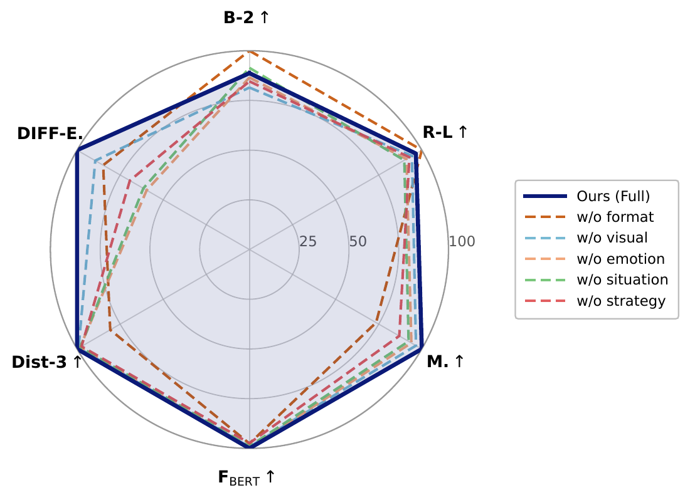

# 🖼️ Paper figures

The four figures below accompany the paper. PDF figures have PNG previews
for inline display. The radar uses an ASCII filename for portable links.

| Paper figure | Original filename | Repository file | Inline image |
| --- | --- | --- | --- |
| Figure 1: support example | `show.png` | [show.png](show.png) | original PNG |
| Figure 2: FACES workflow | `FACES_MAIN5.pdf` | [FACES_MAIN5.pdf](FACES_MAIN5.pdf) | [preview](previews/FACES_MAIN5.png) |
| Figure 3: dimension ablations | `附录雷达图.pdf` | [appendix_ablation_radar.pdf](appendix_ablation_radar.pdf) | [preview](previews/appendix_ablation_radar.png) |
| Figure 4: qualitative cases | `case_study.png` | [case_study.png](case_study.png) | original PNG |

<a href="FACES_MAIN5.pdf"></a>

<a href="appendix_ablation_radar.pdf"></a>


Regenerate the PDF previews with Poppler installed:

```bash
python tools/render_figure_previews.py
```

[Repository overview](../README.md)
